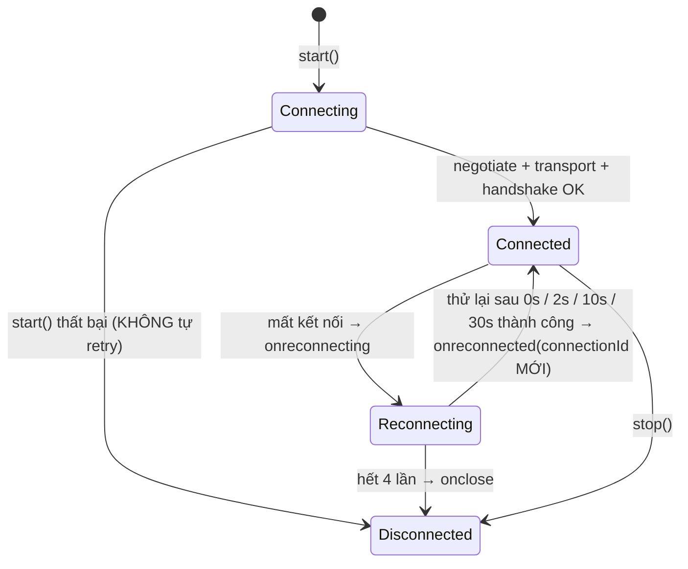
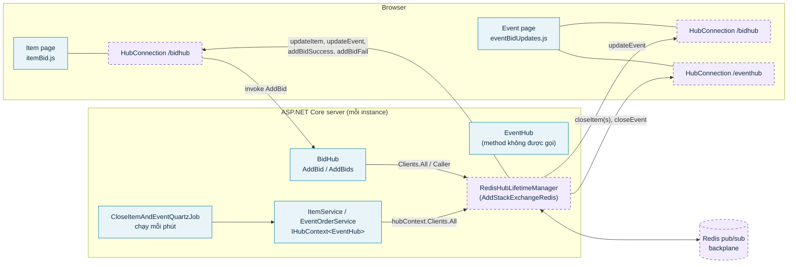
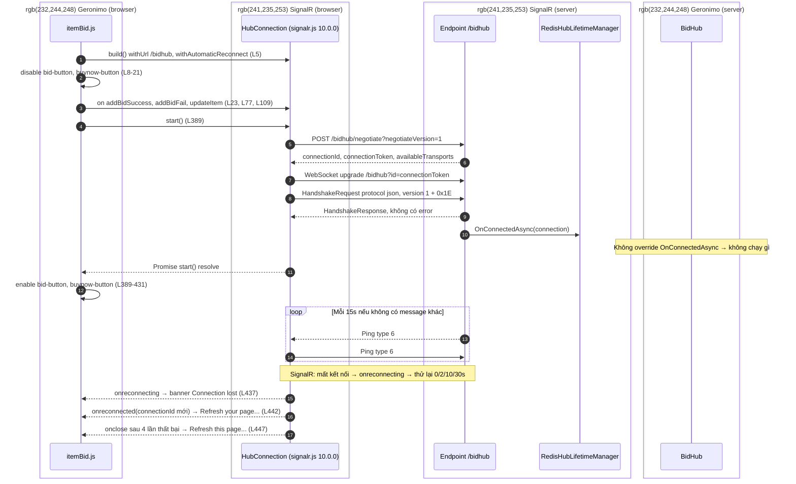
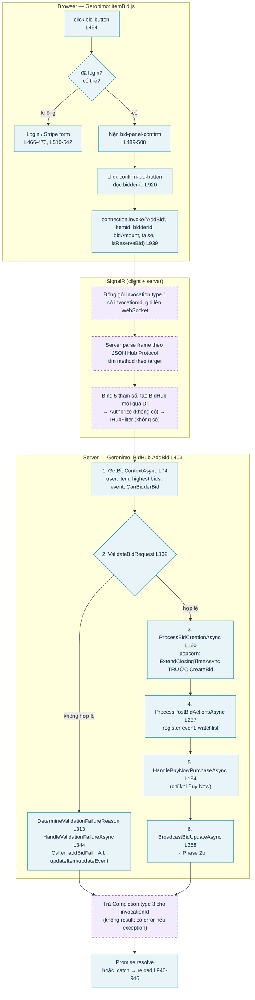
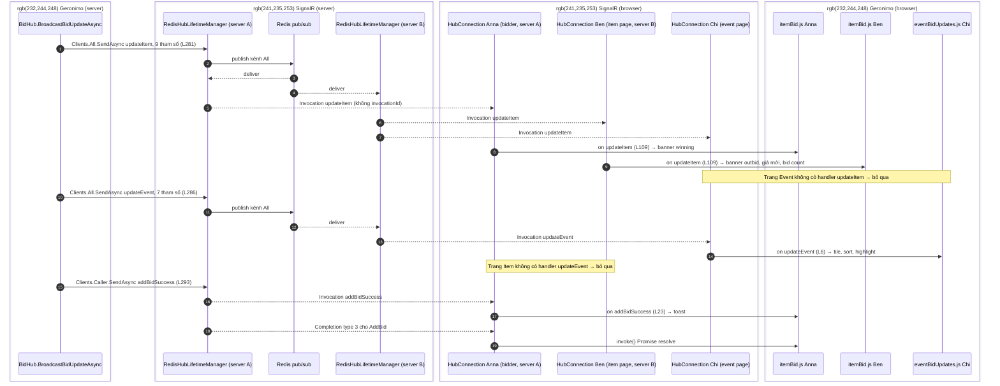
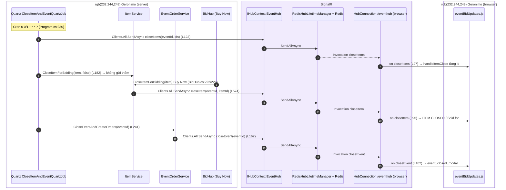

# SignalR: Deep Dive, Geronimo Walkthrough & Challenge Questions

**Người trình bày:** Tavian Nguyen\
**Cập nhật:** 21/10/2026\
**Buổi sharing:** 23/10/2026, 30 phút, nối tiếp buổi ProtoLab "Real-time Communication on the Web"

## Mục tiêu

Tài liệu này phục vụ bốn mục đích:

1. Đặt SignalR đúng chỗ: **framework real-time, không phải một transport**. Hiểu từng lớp bên trong (Hub, HubConnection, HubLifetimeManager, Hub Protocol, negotiate, transport, handshake, keep-alive, reconnect).
2. Chỉ ra SignalR làm thay mình những gì so với WebSocket tự viết ở ProtoLab, khi nào nên dùng và khi nào không.
3. Đi qua code thật của TravelPledgeAuctions (Geronimo), từ high-level xuống detail, tách rõ **phần nào là code Geronimo, phần nào là SignalR làm**.
4. Rút bài học (best practice, lỗi hay gặp) từ chính code của team, kèm bộ câu hỏi phản biện để chuẩn bị Q&A.

Quy ước trong tài liệu:

- Mọi khẳng định về SignalR đều dẫn nguồn Microsoft Learn hoặc spec trong repo `dotnet/aspnetcore`. Số mặc định chỉ ghi khi đã kiểm tra trong docs.
- Mọi khẳng định về Geronimo đều kèm `file:line`, đường dẫn tính từ `Sites/TravelPledgeAuctions/`.
- Server TravelPledgeAuctions là .NET 8 Razor Pages; bundle client là `@microsoft/signalr` **10.0.0** (`wwwroot/js/signalr/dist/browser/signalr.js:307`).
- Những điểm chưa kiểm chứng trên production được ghi rõ **"cần xác nhận với team"**.

## Câu trả lời ngắn nhất

> **SignalR không phải "WebSocket xịn hơn".** WebSocket là đường truyền. SignalR là framework chạy phía trên đường truyền: tự thương lượng transport (WebSocket → SSE → Long polling), quản lý connection, keep-alive, reconnect, cho client và server gọi hàm của nhau (RPC) qua Hub, định tuyến tới All/Caller/User/Group, và scale-out qua backplane. Dev chỉ còn viết business logic.

```text
Business code (Geronimo):  BidHub.AddBid, itemBid.js handlers, ItemService, Quartz job
                                     ↓
SignalR API:               Hub, Clients.All/Caller/User/Group, IHubContext, HubConnection.invoke/on
                                     ↓
SignalR runtime:           HubLifetimeManager (Default | Redis), hub dispatcher, filters, keep-alive, reconnect
                                     ↓
SignalR Hub Protocol:      JSON (mặc định) | MessagePack — Invocation, Completion, Ping, Close...
                                     ↓
Transport:                 WebSocket | SSE + HTTP POST | Long polling + HTTP POST
                                     ↓
Network:                   HTTP / TCP / TLS
```

---

## 1. SignalR là gì, gồm những lớp nào

### 1.1 Định nghĩa và use case

Microsoft mô tả ASP.NET Core SignalR là thư viện open-source giúp thêm tính năng real-time, cho phép server đẩy nội dung xuống client ngay lập tức. Danh sách use case tiêu biểu trong docs có cả **Auctions** (đúng bài toán của TravelPledgeAuctions), dashboard, collaboration, notification. Các tính năng chính được liệt kê: tự quản lý connection, gửi tới mọi client, gửi tới client hoặc group cụ thể, scale qua Azure SignalR Service hoặc Redis backplane. [Microsoft Learn — Overview of ASP.NET Core SignalR](https://learn.microsoft.com/en-us/aspnet/core/signalr/introduction?view=aspnetcore-8.0)

Server SignalR có sẵn trong shared framework của ASP.NET Core, không cần cài thêm package phía server. [Microsoft Learn — Use hubs](https://learn.microsoft.com/en-us/aspnet/core/signalr/hubs?view=aspnetcore-8.0)

### 1.2 Bản đồ các thành phần

| Thành phần | Nằm ở | Vai trò |
|---|---|---|
| **Hub** | Server | Class kế thừa `Hub`. Mỗi method `public` là một endpoint client gọi được. Có `Clients` (gửi đi), `Groups` (quản lý group), `Context` (ConnectionId, UserIdentifier, User...). |
| **HubConnection** | Client (JS, .NET, Java...) | Đối tượng client: `start()`, `invoke()`, `send()`, `on()`, `onreconnecting/onreconnected/onclose`. |
| **HubLifetimeManager&lt;THub&gt;** | Server | Abstraction giữ danh sách connection và group, thực hiện `SendAllAsync`, `SendConnectionAsync`, `SendGroupAsync`, `SendUserAsync`... Bản mặc định là `DefaultHubLifetimeManager` (in-memory); `AddStackExchangeRedis` thay bằng `RedisHubLifetimeManager`. [API reference](https://learn.microsoft.com/en-us/dotnet/api/microsoft.aspnetcore.signalr.hublifetimemanager-1?view=aspnetcore-8.0) |
| **Hub Protocol** | Hai phía | Định nghĩa "message nghĩa là gì": Invocation, Completion, Ping, Close... Có JSON (text, mặc định) và MessagePack (binary). [HubProtocol.md](https://github.com/dotnet/aspnetcore/blob/main/src/SignalR/docs/specs/HubProtocol.md) |
| **Transport** | Hai phía | Byte đi qua mạng bằng cách nào: WebSocket, Server-Sent Events, Long polling. [TransportProtocols.md](https://github.com/dotnet/aspnetcore/blob/main/src/SignalR/docs/specs/TransportProtocols.md) |
| **IHubContext&lt;THub&gt;** | Server | Gửi message tới client từ **ngoài** hub (controller, service, background job). [Microsoft Learn — HubContext](https://learn.microsoft.com/en-us/aspnet/core/signalr/hubcontext?view=aspnetcore-8.0) |
| **IHubFilter** | Server | Pipeline giống middleware, chạy trước/sau mỗi lần client gọi hub method. [Microsoft Learn — Hub filters](https://learn.microsoft.com/en-us/aspnet/core/signalr/hub-filters?view=aspnetcore-8.0) |

Demo **BidLab** của buổi này dùng đúng hai điểm móc chính thức để cho thấy SignalR đang làm gì: `TracingHubLifetimeManager` (kế thừa `DefaultHubLifetimeManager`, ghi trace khi `SendAllAsync`/`SendConnectionAsync`) và `TraceHubFilter` (`IHubFilter`, ghi trace ngay trước khi gọi `BidHub.AddBid`). Xem `SignalR/bidlab/src/BidLab/Tracing/`.

### 1.3 Transport và fallback

SignalR hỗ trợ ba transport, theo thứ tự fallback: **WebSockets → Server-Sent Events → Long polling**, và "tự chọn transport tốt nhất trong khả năng của server và client". [Overview](https://learn.microsoft.com/en-us/aspnet/core/signalr/introduction?view=aspnetcore-8.0)

Mặc định mọi transport đều bật. Có thể giới hạn ở server (`HttpTransportType`) hoặc client. [Configuration](https://learn.microsoft.com/en-us/aspnet/core/signalr/configuration?view=aspnetcore-8.0)

SSE và Long polling chỉ chạy server → client. Chiều client → server luôn ghép với **HTTP POST** tới `[endpoint-base]`. Nhờ vậy API vẫn hai chiều dù transport bên dưới là một chiều. [TransportProtocols.md](https://github.com/dotnet/aspnetcore/blob/main/src/SignalR/docs/specs/TransportProtocols.md)

### 1.4 Negotiate

Trước khi mở transport, client gửi `POST [endpoint-base]/negotiate?negotiateVersion=1`. Response (ví dụ trong spec, version 1):

```json
{
  "connectionToken": "05265228-1e2c-46c5-82a1-6a5bcc3f0143",
  "connectionId": "807809a5-31bf-470d-9e23-afaee35d8a0d",
  "negotiateVersion": 1,
  "availableTransports": [
    { "transport": "WebSockets",       "transferFormats": [ "Text", "Binary" ] },
    { "transport": "ServerSentEvents", "transferFormats": [ "Text" ] },
    { "transport": "LongPolling",      "transferFormats": [ "Text", "Binary" ] }
  ]
}
```

Điểm cần nhớ từ spec:

- `connectionToken` được đưa vào query `id` của các request tiếp theo và **phải giữ bí mật**. `connectionId` là giá trị app thấy qua `Context.ConnectionId`; docs vẫn khuyên không chia sẻ nó cho client khác. [Security](https://learn.microsoft.com/en-us/aspnet/core/signalr/security?view=aspnetcore-8.0)
- Với WebSocket, `id` là tùy chọn; với SSE, HTTP POST và Long polling thì `id` bắt buộc.
- Có thể bỏ bước negotiate bằng `skipNegotiation: true`, nhưng **chỉ khi WebSocket là transport duy nhất**, và không dùng được với Azure SignalR Service. [Configuration](https://learn.microsoft.com/en-us/aspnet/core/signalr/configuration?view=aspnetcore-8.0)

Ở Geronimo, `itemBid.js:5` dùng `withUrl("/bidhub")` không kèm option, nên client đi đủ negotiate và giữ fallback.

### 1.5 Handshake

Ngay sau khi transport mở, tin nhắn đầu tiên của client **phải** là `HandshakeRequest`. Handshake luôn là JSON (kể cả khi chọn MessagePack) và kết thúc bằng ký tự **`0x1E`** (ASCII record separator). Server trả `HandshakeResponse`; response chỉ có field `error` khi thất bại, nên **response không có `error` nghĩa là thành công**. Nếu tin đầu tiên không phải handshake, server đóng connection. [HubProtocol.md](https://github.com/dotnet/aspnetcore/blob/main/src/SignalR/docs/specs/HubProtocol.md)

```text
client → server   {"protocol":"json","version":1}␞
server → client   {}␞                                   (không có "error" ⇒ OK)
```

Server ASP.NET Core ghi response thành công là JSON object rỗng: `WriteResponseMessage` chỉ thêm `error` khi có lỗi, và `GetSuccessHandshakeData` dùng `HandshakeResponseMessage.Empty`. [HandshakeProtocol.cs](https://github.com/dotnet/aspnetcore/blob/main/src/SignalR/common/SignalR.Common/src/Protocol/HandshakeProtocol.cs)

`␞` trong tài liệu này là ký hiệu cho byte `0x1E`. Server đóng connection nếu client không gửi handshake trong `HandshakeTimeout`, mặc định **15 giây**. [Configuration](https://learn.microsoft.com/en-us/aspnet/core/signalr/configuration?view=aspnetcore-8.0)

### 1.6 Hub Protocol: các loại message và frame thật

Với JSON Hub Protocol, mỗi message là một JSON object kết thúc bằng `0x1E`. Field `type` cho biết loại message:

| `type` | Message | Ý nghĩa |
|---|---|---|
| 1 | Invocation | Gọi một method ở phía bên kia (`target` + `arguments`) |
| 2 | StreamItem | Một phần tử của stream |
| 3 | Completion | Kết thúc một Invocation có `invocationId`: kèm `result` hoặc `error` |
| 4 | StreamInvocation | Gọi method trả về stream |
| 5 | CancelInvocation | Hủy invocation/stream |
| 6 | Ping | Keep-alive |
| 7 | Close | Đóng connection, có thể kèm `error` và `allowReconnect` |
| 8 | Ack | Dùng cho stateful reconnect |
| 9 | Sequence | Dùng cho stateful reconnect |

Nguồn: [HubProtocol.md](https://github.com/dotnet/aspnetcore/blob/main/src/SignalR/docs/specs/HubProtocol.md). MessagePack thì mỗi frame có tiền tố độ dài dạng VarInt (1–5 byte) thay cho `0x1E`.

Hai khái niệm quan trọng:

- **Blocking invocation** có `invocationId`: bên nhận phải trả `Completion`. Đây là cái `connection.invoke(...)` dùng; Promise resolve khi nhận Completion, reject nếu Completion có `error`.
- **Non-blocking invocation** không có `invocationId`: bên nhận **không được** trả lời. Đây là cái server dùng khi gọi `Clients.X.SendAsync(...)`, và cái client dùng khi gọi `connection.send(...)`. [JavaScript client](https://learn.microsoft.com/en-us/aspnet/core/signalr/javascript-client?view=aspnetcore-8.0)
- Với method `void`/`Task`, Completion **không có field `result`**.

Frame minh họa theo đúng chữ ký của Geronimo (giá trị là ví dụ, `<id>` là placeholder do client tự sinh):

```text
// 1) Client gọi BidHub.AddBid (itemBid.js:939) — Invocation, CÓ invocationId
{"type":1,"invocationId":"<id>","target":"AddBid","arguments":[1042,"<bidderId>",1300,false,true]}␞

// 2) Server broadcast cập nhật (BidHub.cs:281) — Invocation, KHÔNG có invocationId
{"type":1,"target":"updateItem","arguments":[1042,1300,1350,8,"10/23/2026 9:00 PM",3600.5,"<highBidUserId>",true,1500]}␞

// 3) Server báo riêng cho người bid (BidHub.cs:293)
{"type":1,"target":"addBidSuccess","arguments":[1042,"<bidderId>",true]}␞

// 4) AddBid trả Task (void) — Completion KHÔNG có "result"
{"type":3,"invocationId":"<id>"}␞

// 5) AddBid ném exception — Completion có "error"
{"type":3,"invocationId":"<id>","error":"<thông báo lỗi>"}␞

// 6) Keep-alive
{"type":6}␞
```

Thứ tự tham số `AddBid(itemId, bidderId, bidAmount, isBuyNow, isMaxBid)` khớp `BidHub.cs:403` và lời gọi `itemBid.js:939`. Chín tham số của `updateItem` khớp `BidHub.cs:281-283` và handler `itemBid.js:109`.

### 1.7 Keep-alive và timeout

Theo spec, cả hai phía đều có thể gửi Ping; bên nhận không bắt buộc trả lời mà thường chỉ reset bộ đếm timeout. Ping chỉ được gửi khi trong khoảng đó **chưa có message nào khác**. Bên nào không nhận được gì trong thời gian timeout thì đóng connection. [HubProtocol.md](https://github.com/dotnet/aspnetcore/blob/main/src/SignalR/docs/specs/HubProtocol.md)

Giá trị mặc định ([Configuration](https://learn.microsoft.com/en-us/aspnet/core/signalr/configuration?view=aspnetcore-8.0)):

| Phía | Option | Mặc định | Ghi chú |
|---|---|---|---|
| Server | `KeepAliveInterval` | 15 giây | Chu kỳ server gửi ping |
| Server | `ClientTimeoutInterval` | 30 giây | Không nhận gì từ client trong khoảng này ⇒ coi là mất; khuyến nghị = 2 × KeepAliveInterval |
| Server | `HandshakeTimeout` | 15 giây | |
| JS client | server timeout (`serverTimeoutInMilliseconds` / `withServerTimeout`) | 30 giây | Không nhận gì từ server ⇒ `onclose` (hoặc reconnect nếu bật) |
| JS client | keep-alive (`keepAliveIntervalInMilliseconds` / `withKeepAliveInterval`) | 15 giây | Nên ≤ một nửa server timeout |

Quy tắc cần nhớ: **đổi `KeepAliveInterval` ở server thì phải đổi server timeout ở client** (khuyến nghị ít nhất gấp đôi). TravelPledgeAuctions không chỉnh các giá trị này (`Program.cs:216-219` chỉ đặt `EnableDetailedErrors`), tức là đang chạy mặc định.

Đây chính là phần heartbeat mà ProtoLab phải tự viết: SignalR có sẵn ở cả hai phía, ở tầng Hub Protocol.

### 1.8 Automatic reconnect

JavaScript client **không tự reconnect nếu không gọi `withAutomaticReconnect()`**. Khi gọi không tham số, client chờ **0, 2, 10, 30 giây** trước mỗi lần thử, và dừng sau 4 lần thất bại. [JavaScript client](https://learn.microsoft.com/en-us/aspnet/core/signalr/javascript-client?view=aspnetcore-8.0)

Toàn bộ sơ đồ dưới đây là hành vi của **SignalR JS client**; code Geronimo chỉ gắn vào các callback `onreconnecting`/`onreconnected`/`onclose`.



Những điều docs nói rõ và hay bị hiểu sai:

- Khi reconnect thành công, server coi đây là **connection hoàn toàn mới**, `onreconnected` nhận `connectionId` mới.
- `withAutomaticReconnect` **không retry khi `start()` lần đầu thất bại**; phải tự viết vòng retry.
- Có thể truyền mảng delay riêng, ví dụ `[0, 2000, 10000, 30000]` chính là mặc định, hoặc một `IRetryPolicy`.
- Group membership **không được giữ** khi connection reconnect; phải join lại. [Users and groups](https://learn.microsoft.com/en-us/aspnet/core/signalr/groups?view=aspnetcore-8.0)
- Reconnect chỉ mở lại đường truyền. Message phát ra trong lúc đứt **không tự được gửi bù**, trừ khi bật **stateful reconnect** (từ .NET 8, opt-in ở cả server `AllowStatefulReconnects` lẫn client `withStatefulReconnect`; server buffer mặc định 100.000 byte; nó dành cho đứt mạng tạm thời). [Configuration — stateful reconnect](https://learn.microsoft.com/en-us/aspnet/core/signalr/configuration?view=aspnetcore-8.0#configure-stateful-reconnect). TravelPledgeAuctions không bật tính năng này.

### 1.9 Hub là transient

Mỗi lần client gọi hub method, SignalR tạo **một instance hub mới**; service scoped cũng được tạo theo từng invocation. Vì vậy không lưu state trong property của hub. Không tự tạo hub qua DI; muốn gửi từ nơi khác thì dùng `IHubContext`. [Use hubs](https://learn.microsoft.com/en-us/aspnet/core/signalr/hubs?view=aspnetcore-8.0)

Đường đi của một Invocation phía server: parse frame theo Hub Protocol → tìm method theo `target` → bind tham số, tạo instance hub → `[Authorize]` của method → chuỗi `IHubFilter` → gọi method → nếu là blocking invocation thì gửi Completion. Docs nói rõ `[Authorize]` trên hub method chạy **trước** hub filter, và khi filter chạy thì `HubInvocationContext` đã có sẵn `Hub` (instance) và `HubMethodArguments` (tham số đã bind). [Hub filters](https://learn.microsoft.com/en-us/aspnet/core/signalr/hub-filters?view=aspnetcore-8.0). `TraceHubFilter` của demo BidLab móc đúng vào điểm này.

Mặc định `MaximumParallelInvocationsPerClient = 1`: mỗi client chỉ chạy một hub method tại một thời điểm, các lời gọi sau **xếp hàng**. [Configuration](https://learn.microsoft.com/en-us/aspnet/core/signalr/configuration?view=aspnetcore-8.0)

---

## 2. SignalR làm gì thay mình, và khi nào nên dùng

### 2.1 Nhìn lại ProtoLab: những gì mình đã tự làm

Ở ProtoLab, với raw WebSocket mình phải tự quyết định và tự viết: schema message, correlation request/response, heartbeat, phát hiện half-open, reconnect/backoff, room, fan-out, auth, fallback khi WebSocket bị chặn, và scale nhiều instance. Đối chiếu:

| Việc phải làm | Raw WebSocket (ProtoLab) | SignalR |
|---|---|---|
| Chọn transport, fallback | Tự viết hoặc không có | Negotiate + WebSocket → SSE → Long polling |
| Format message, phân biệt "gọi hàm" với "kết quả" | Tự định nghĩa JSON | Hub Protocol: Invocation / Completion / Ping / Close |
| Gọi hàm server và chờ kết quả | Tự gắn request id, tự map response | `invoke()` trả Promise, server trả Completion |
| Server gọi hàm client | Tự `switch(type)` | `Clients.X.SendAsync("name", ...)` ↔ `connection.on("name", ...)` |
| Heartbeat, timeout | Tự viết | Ping `type:6`, KeepAlive 15s / timeout 30s |
| Reconnect + backoff | Tự viết | `withAutomaticReconnect()` 0/2/10/30s |
| Gửi tới một user, nhiều tab | Tự map user → socket | `Clients.User(id)` theo `Context.UserIdentifier` |
| Room | Tự giữ `Map<room, Set<socket>>` | `Groups.AddToGroupAsync` + `Clients.Group` |
| Gửi từ background job | Tự lấy danh sách socket | `IHubContext<THub>` qua DI |
| Nhiều server | Tự dựng pub/sub | `AddStackExchangeRedis(...)` hoặc Azure SignalR Service |
| Auth | Tự kiểm tra ở handshake | Dùng chung auth ASP.NET Core, `[Authorize]`, `Context.User` |

Những gì SignalR **không** làm thay: thiết kế dữ liệu bị lỡ khi mất kết nối (resync/replay ở tầng nghiệp vụ), idempotency, exactly-once, phân quyền cho từng action. Đây là việc của ứng dụng, giống kết luận ở ProtoLab.

### 2.2 Các cách gửi (senders)

`Hub.Clients` có ([Use hubs](https://learn.microsoft.com/en-us/aspnet/core/signalr/hubs?view=aspnetcore-8.0)):

| API | Gửi tới |
|---|---|
| `Clients.All` | Mọi connection của hub |
| `Clients.Caller` | Connection vừa gọi hub method |
| `Clients.Others` | Mọi connection trừ caller |
| `Clients.AllExcept(ids)` | Mọi connection trừ danh sách |
| `Clients.Client(id)` / `Clients.Clients(ids)` | Connection cụ thể |
| `Clients.User(userId)` / `Clients.Users(ids)` | Mọi connection của user đó (nhiều tab, nhiều thiết bị) |
| `Clients.Group(name)` / `Groups(names)` / `GroupExcept` / `OthersInGroup` | Connection trong group |

Ghi chú:

- `Clients.User` dựa trên `Context.UserIdentifier`, mặc định là claim `ClaimTypes.NameIdentifier`; đổi được bằng `IUserIdProvider`. User id phân biệt hoa thường. [Users and groups](https://learn.microsoft.com/en-us/aspnet/core/signalr/groups?view=aspnetcore-8.0)
- Group do ứng dụng quản lý, tên phân biệt hoa thường, không đếm được thành viên khi scale nhiều server, và **không phải tính năng bảo mật**. [Users and groups](https://learn.microsoft.com/en-us/aspnet/core/signalr/groups?view=aspnetcore-8.0)
- `IHubContext` gửi được từ controller, middleware, service. Vì không có "người gọi", **không có `Caller`, `Others`, `ConnectionId`**. [HubContext](https://learn.microsoft.com/en-us/aspnet/core/signalr/hubcontext?view=aspnetcore-8.0)
- `SendAsync` dựa trên chuỗi tên method. `Hub<T>` (strongly typed hub) cho kiểm tra lúc compile. [Use hubs](https://learn.microsoft.com/en-us/aspnet/core/signalr/hubs?view=aspnetcore-8.0)

### 2.3 Khi nào nên, khi nào không

| Lựa chọn | Hợp khi | Không hợp khi |
|---|---|---|
| **SignalR** | Backend ASP.NET Core; cần RPC hai chiều, All/User/Group, reconnect, fallback; cần push từ background job; muốn scale-out bằng Redis/Azure | Client không dùng được SDK SignalR (thiết bị, ngôn ngữ ngoài hệ supported); cần protocol riêng do bên thứ ba định nghĩa |
| **Raw WebSocket** | Cần kiểm soát protocol/subprotocol ở mức thấp, tương thích hệ sinh thái khác, đã có sẵn hạ tầng routing/replay | Team phải tự xây lại mọi thứ ở bảng 2.1 |
| **SSE** | Server stream text một chiều (progress, token LLM, notification) và HTTP POST đủ cho chiều ngược lại | Client gửi lên dày, cần binary |
| **Polling / Long polling** | Cập nhật thưa, cần đơn giản, dễ debug, chạy qua mọi proxy | Cần độ trễ thấp và nhiều người cùng xem |
| **Socket.IO** | Backend Node.js. Có fallback long-polling, auto reconnect, packet buffering, ack, broadcast, room, namespace | Backend .NET. Lưu ý: Socket.IO **không phải** một WebSocket implementation; client WebSocket thường không nói chuyện được với server Socket.IO và ngược lại. [Socket.IO docs](https://socket.io/docs/v4/) |
| **Azure SignalR Service (managed)** | Host trên Azure; muốn bỏ sticky session, để service giữ connection, app chỉ scale theo lượng message. Microsoft khuyến nghị cho app SignalR host trên Azure. [Scale](https://learn.microsoft.com/en-us/aspnet/core/signalr/scale?view=aspnetcore-8.0) | Host on-premises với độ trễ lớn tới data center Azure |

Microsoft nêu ví dụ "Auctions" trong nhóm app cần cập nhật tần suất cao từ server. TravelPledgeAuctions nằm đúng nhóm đó.

---

## 3. Setup mindset (high-level, không đi vào từng dòng code)

Câu hỏi đúng không phải "cài thế nào" mà "cần chuẩn bị gì để nó chạy ổn trong production".

1. **Server đã có sẵn.** SignalR server nằm trong ASP.NET Core. Việc của mình: `AddSignalR()` để đăng ký service, `MapHub<THub>("/path")` để mở endpoint. Ở Geronimo: `Program.cs:216-219` và `Program.cs:117-118`.
2. **Thiết kế hub như thiết kế API public.** Mọi method `public` của hub là endpoint client gọi được. Quyết định: method nào client được gọi, tham số nào lấy từ client, tham số nào phải lấy từ server (user, quyền).
3. **Thiết kế "ai nhận gì".** Event nào gửi All, event nào gửi theo Group (event, item), event nào gửi User. Đặt tên event và thứ tự tham số như một hợp đồng giữa server và client.
4. **Client library.** Trình duyệt dùng `@microsoft/signalr` (npm/CDN/LibMan). Đăng ký `on(...)` **trước** `start()` để không lỡ message đầu. Bật `withAutomaticReconnect()`, tự xử lý `start()` thất bại, và có UI cho reconnecting/closed. [JavaScript client](https://learn.microsoft.com/en-us/aspnet/core/signalr/javascript-client?view=aspnetcore-8.0)
5. **Auth.** Trong browser, cookie auth tự đi theo connection, không cần cấu hình thêm. Bearer token đi qua `accessTokenFactory`; với WebSocket/SSE, browser gửi token qua query `access_token`, nên cần tránh log URL. Dùng `[Authorize]` trên hub hoặc từng method, lấy user từ `Context.UserIdentifier`/`Context.User`. Lưu ý: SignalR không tự revalidate user trong suốt connection (với LongPolling/SSE, auth chạy mỗi request nhưng principal được cache); mặc định connection vẫn chạy khi token hết hạn giữa chừng. [Authentication and authorization](https://learn.microsoft.com/en-us/aspnet/core/signalr/authn-and-authz?view=aspnetcore-8.0), [Security](https://learn.microsoft.com/en-us/aspnet/core/signalr/security?view=aspnetcore-8.0)
6. **Hạ tầng.**
   - Reverse proxy/load balancer phải cho phép WebSocket upgrade; nếu không, SignalR vẫn chạy nhưng rơi xuống SSE/Long polling. Ví dụ cấu hình Nginx trong docs có `Upgrade`/`Connection` header, `proxy_buffering off` cho SSE và `proxy_read_timeout` cho Long polling. [Scale — Nginx](https://learn.microsoft.com/en-us/aspnet/core/signalr/scale?view=aspnetcore-8.0#linux-with-nginx)
   - **Sticky session** bắt buộc khi chạy nhiều server, **kể cả khi có Redis backplane**. Ba ngoại lệ: một server một process; dùng Azure SignalR Service; hoặc mọi client chỉ dùng WebSocket **và** bật `skipNegotiation`. [Scale](https://learn.microsoft.com/en-us/aspnet/core/signalr/scale?view=aspnetcore-8.0)
   - **Backplane** khi nhiều server: Redis (`AddStackExchangeRedis`) hoặc Azure SignalR Service. Redis backplane nên ở cùng data center; nếu nhiều app dùng chung Redis thì đặt `ChannelPrefix` khác nhau; khi Redis down, message gửi trong lúc đó **mất**, SignalR không buffer. [Redis backplane](https://learn.microsoft.com/en-us/aspnet/core/signalr/redis-backplane?view=aspnetcore-8.0)
   - Connection SignalR là persistent, tốn TCP connection và bộ nhớ; nếu dùng chung server với app khác, có thể làm cạn connection của app đó. [Scale](https://learn.microsoft.com/en-us/aspnet/core/signalr/scale?view=aspnetcore-8.0)
7. **Timeout và giới hạn.** Hiểu các mặc định ở mục 1.7. Giữ `EnableDetailedErrors = false` ở production. `MaximumReceiveMessageSize` mặc định 32 KB, tăng lên làm tăng rủi ro DoS. [Configuration](https://learn.microsoft.com/en-us/aspnet/core/signalr/configuration?view=aspnetcore-8.0)
8. **CORS** chỉ cần khi client ở origin khác; CORS **không** bảo vệ WebSocket, phải giới hạn origin riêng. [Security](https://learn.microsoft.com/en-us/aspnet/core/signalr/security?view=aspnetcore-8.0)

---

## 4. Geronimo: TravelPledgeAuctions dùng SignalR thế nào

### 4.1 Toàn cảnh

**Server**

- `Program.cs:216-219`: `AddSignalR(options => options.EnableDetailedErrors = true).AddStackExchangeRedis(builder.Configuration.GetConnectionString("Redis"))`. Có **Redis backplane**.
- `Program.cs:117-118`: `MapHub<BidHub>("/bidhub")`, `MapHub<EventHub>("/eventhub")`. **Không có `MapHub<MessageHub>`.**
- `Program.cs:105-106`: `UseAuthentication()`/`UseAuthorization()` chạy trước khi map hub, nên `Context.User` của hub có user đăng nhập bằng cookie Identity.
- `Hubs/BidHub.cs`: hai method client gọi được, `AddBid` (L403) và `AddBids` (L451).
- `Hubs/EventHub.cs`: ba method `CloseItem`, `CloseItems`, `CloseEvent` (L11-23), mỗi cái `Clients.All.SendAsync(...)`. Thực tế server **không gọi các method này**; server gửi qua `IHubContext<EventHub>`.
- `IHubContext<EventHub>` được inject ở `ItemService` (L30, L41), `EventService` (L28), `EventOrderService` (L28) và lấy từ scope trong `CloseItemAndEventQuartzJob` (L55).
- `Hubs/MessageHub.cs` + `Services/Notifications/WebService.cs` + `wwwroot/js/signalr/TPAuctions_SignalR.js`: xem 4.6.

**Client** (bundle `signalr.js` nạp ở `Pages/Shared/_LayoutEvent.cshtml:99`, dùng cho cả `Item.cshtml:7` và `Event.cshtml:13`)

- Trang Item: `wwwroot/js/itemBid.js` (nạp ở `Item.cshtml:927`), **một** connection tới `/bidhub`.
- Trang Event: `wwwroot/js/eventBidUpdates.js` (nạp ở `Event.cshtml:606`), **hai** connection `/bidhub` và `/eventhub` (L3-4).



Chú giải màu dùng chung cho mọi sơ đồ: **xanh cyan, viền liền = code Geronimo**; **tím, viền đứt = SignalR làm**.

Ma trận "event nào, ai nghe":

| Event | Server gửi ở | Trang Item (`itemBid.js`) | Trang Event (`eventBidUpdates.js`) |
|---|---|---|---|
| `updateItem` (9 tham số) | `BidHub.cs:281`, `:355` | Có handler, L109 | **Không có handler** |
| `updateEvent` (7 tham số) | `BidHub.cs:286`, `:357` | **Không có handler** | Có handler, L6 |
| `addBidSuccess` | `BidHub.cs:293` (Caller) | Có handler, L23 | Không |
| `addBidFail` | `BidHub.cs:305` (Caller) | Có handler, L77 | Không |
| `closeItem` / `closeItems` / `closeEvent` | `ItemService.cs:574`, `CloseItemAndEventQuartzJob.cs:122`, `EventOrderService.cs:162` | **Không nghe** (trang Item không kết nối `/eventhub`) | Có handler, L95 / L97 / L102 |

Vì gửi bằng `Clients.All` trên cùng hub `/bidhub`, trang Item vẫn nhận frame `updateEvent` và trang Event vẫn nhận frame `updateItem`; client không đăng ký handler cho event đó nên frame chỉ bị bỏ qua.

### 4.2 Phase 1: kết nối vào bid

**Geronimo làm gì**

1. `itemBid.js:5` tạo connection: `new signalR.HubConnectionBuilder().withUrl("/bidhub").withAutomaticReconnect().build()`.
2. `itemBid.js:8-21`: disable nút PLACE BID (đổi chữ thành `calculating...`) và Buy Now (`...`) cho tới khi kết nối xong.
3. `itemBid.js:23`, `:77`, `:109`: đăng ký handler `addBidSuccess`, `addBidFail`, `updateItem` **trước** `start()`, đúng khuyến nghị của docs.
4. `itemBid.js:389-431`: `connection.start().then(...)` bật lại nút bid và Buy Now.
5. `itemBid.js:432-434`: `start()` lỗi thì `alert(err)`, không retry.
6. `itemBid.js:437-451`: `onreconnecting` hiện "Connection to WinningBidder.com was lost… Attempting to reconnect…", `onreconnected` hiện "You're connected… Refresh your page for the latest bid updates.", `onclose` hiện "…closed due to an error. Refresh this page…".

**SignalR làm gì** (không có dòng code nào của Geronimo cho các bước này): negotiate, chọn transport, mở WebSocket, handshake, thêm connection vào `HubLifetimeManager` (với Redis backplane: thông tin connection được chuyển cho backplane), ping định kỳ, phát hiện mất kết nối, thử lại theo 0/2/10/30s, gọi các callback.

`BidHub` không override `OnConnectedAsync`/`OnDisconnectedAsync`, nên ở Phase 1 **code Geronimo phía server không chạy dòng nào**.



Frame thật của Phase 1 (dạng text WebSocket):

```text
→ {"protocol":"json","version":1}␞
← {}␞
← {"type":6}␞
→ {"type":6}␞
```

Trang Event làm tương tự với hai connection (`eventBidUpdates.js:3-4`, start ở L115-116). Khác biệt: `start()` lỗi bị nuốt im lặng (`.catch(function (err) { })`), và chỉ `bidHub` có callback reconnect (L118-134); `eventHub` không có.

### 4.3 Phase 2a: bấm PLACE BID tới khi `AddBid` chạy xong

**Phía client (Geronimo)**

- `itemBid.js:454-545`, click `bid-button`: nếu chưa đăng nhập (`bidder-id` rỗng) thì chuyển tới Login/Register (L466-473); nếu event yêu cầu thẻ mà chưa có thì mở form Stripe (L510-542); nếu ổn thì ẩn `.bid-panel`, hiện `.bid-panel-confirm` (L489-508). **Chưa có gì đi qua SignalR.**
- `itemBid.js:903-957`, click `confirm-bid-button`: đổi chữ "Placing bid...", disable nút, tính `isReserveBid` (= max bid), đọc `bidderId` từ hidden field `#bidder-id` (L920; field render ở `Item.cshtml:369` từ `Model.UserId`), rồi:
  - số lượng > 1: `connection.invoke("AddBids", itemId, bidderId, bidAmount, false, isReserveBid, quantityItem)` (L930);
  - còn lại: `connection.invoke("AddBid", itemId, bidderId, bidAmount, false, isReserveBid)` (L939);
  - `.catch(...)` → `document.location.reload()` (L940-946).

**SignalR**: đóng gói Invocation có `invocationId`, ghi lên WebSocket; server parse frame, tìm method `AddBid`, bind 5 tham số, tạo instance `BidHub` mới qua DI, rồi gọi method (Geronimo không có `[Authorize]`, không có filter).

**Phía server (Geronimo), `BidHub.AddBid` (L403-438)** gồm 6 bước:

1. **`GetBidContextAsync`** (L74-125): gom dữ liệu một lần vào `BidContext`: user (`GetUserByIdCache`), item, `GetHighestBids` (highest bid và highest max bid), event (`GetEventLiteByIdCache`), `AvailableForBidding` + `ValidateEvent`, `CanBidderBid`. Comment ở L76-79 ghi rõ chạy tuần tự để tránh lỗi concurrency của DbContext.
2. **`ValidateBidRequest`** (L132-144): bid phải cao hơn bid hiện tại (trừ Buy Now), item còn mở, user được phép bid, Buy Now còn hiệu lực. Nếu sai: `DetermineValidationFailureReason` (L313-335) trả `ITEM_CLOSED`, `ALREADY_WON`, `BUY_NOW_UNAVAILABLE`, `BID_TOO_LOW`, `QUANTITY_UNAVAILABLE` hoặc `UNKNOWN`; `HandleValidationFailureAsync` (L344-359) gửi `addBidFail` cho **Caller**, rồi phát `updateItem`/`updateEvent` với trạng thái hiện tại cho **All**; `return`.
3. **`ProcessBidCreationAsync`** (L160-186): nếu event bật popcorn bidding thì `ExtendClosingTimeAsync` chạy **trước** `BidService.CreateBid` (comment L155-156, L162-169: tránh race với job đóng item).
4. **`ProcessPostBidActionsAsync`** (L237-249): đăng ký user vào event, thêm item vào watchlist.
5. **`HandleBuyNowPurchaseAsync`** (L194-230): chỉ chạy khi Buy Now; có thể gọi `ItemService.CloseItemForBidding` (L222, L228), từ đó phát `closeItem` (xem 4.5).
6. **`BroadcastBidUpdateAsync`** (L258-294): xem Phase 2b.

Nếu có exception: `catch` (L431-437) ghi console, gửi `addBidFail ... "UNKNOWN"` cho Caller, rồi `throw`. Exception đó làm SignalR trả Completion có `error`; client vào `.catch` và reload trang.



### 4.4 Phase 2b: mọi người nhận cập nhật

**Geronimo, `BroadcastBidUpdateAsync` (L258-294)**

- Tính `secondsToNextUpdate` từ `ClosingTime` đã có thể được gia hạn (L267-268).
- `uid = context.CurrentBid.HighBidUserId ?? context.BidderId` (L275). Comment "CRITICAL BUG FIX" (L270-274): người bấm nút chưa chắc là người đang thắng, vì bid của họ có thể kích hoạt auto-bid từ max bid của người khác.
- Đọc lại highest max bid sau khi lưu (L277-278).
- `Clients.All.SendAsync("updateItem", itemId, amount, nextBidIncrement, numberOfBids, closingTime, secondsToNextUpdate, uid, true, highestMaxBid)` (L281-283).
- `Clients.All.SendAsync("updateEvent", itemId, amount, nextBidIncrement, numberOfBids, closingTime, uid, true)` (L286-288).
- `Clients.Caller.SendAsync("addBidSuccess", itemId, bidderId, isHighBidder)` với `isHighBidder = HighBidUserId == BidderId` (L292-293).

**SignalR**: `Clients.All` và `Clients.Caller` đi vào `HubLifetimeManager`. Với `RedisHubLifetimeManager`, message "gửi tất cả" được publish lên Redis; mỗi server nhận và ghi xuống các connection nó đang giữ. [Scale — Redis backplane](https://learn.microsoft.com/en-us/aspnet/core/signalr/scale?view=aspnetcore-8.0#redis-backplane). Mỗi message là một Invocation **không có** `invocationId`, client không trả lời.

**Geronimo, client handlers**

- `itemBid.js:109-313` (`updateItem`): chỉ xử lý nếu `itemId` khớp `#item-id` (L110-112). Cập nhật số bid, giá hiện tại, bước giá, so `bidder-id` với `highBidderUserId` để hiện banner **winning** hoặc **outbid** (L179-229), ẩn/hiện Buy Now theo highest max bid (L169-174, L233-240), reset đồng hồ đếm ngược theo `secondsToNextUpdate` (L270-277).
- `itemBid.js:23-75` (`addBidSuccess`): toast "You're winning!" hoặc "…immediately outbid by another bidder's max bid." (L59-63); bật icon watchlist (L70-74).
- `itemBid.js:77-107` (`addBidFail`): toast theo `errorReason`, reload sau 1,5 giây, gọi `updateItemStatus` (AJAX `/api/items/{id}`).
- `eventBidUpdates.js:6-87` (`updateEvent`): cập nhật tile của item, banner winning/outbid theo `#current-user-id` (L41-75), sắp xếp lại tile (L81-83), highlight (L85).
- **Trang Item không có handler `updateEvent`**; chỉ `eventBidUpdates.js` xử lý event này.



Sơ đồ vẽ hai server A/B để thấy vai trò backplane. Production có chạy nhiều instance hay không là thông tin hạ tầng, **cần xác nhận với team** (Quartz bật `UseClustering()` ở `Program.cs:314`, gợi ý có nhiều node, nhưng chưa phải bằng chứng).

### 4.5 Server tự đẩy: đóng item, đóng event

Đây là ví dụ server push **không cần client gọi gì**: code nghiệp vụ lấy `IHubContext<EventHub>` qua DI và gửi thẳng. Có **ba đường khác nhau**:

| Đường | Trigger | Gửi | Ở đâu |
|---|---|---|---|
| A. Quartz đóng item theo lô | Cron mỗi phút (`Program.cs:327-330`) | `closeItems(eventId, itemIds[])` cho All, mỗi event một lần | `CloseItemAndEventQuartzJob.cs:115-128`, gửi ở L122 |
| B. Đóng một item ngay | `ItemService.CloseItemForBidding(item, sendNotification: true)` (L440-458), thực tế đến từ Buy Now trong `BidHub.cs:222`, `:228` | `closeItem(eventId, itemId)` cho All | `ItemService.cs:570-582`, gửi ở L574 |
| C. Đóng event | Job gọi `EventOrderService.CloseEventAndCreateOrders` (`CloseItemAndEventQuartzJob.cs:241`) | `closeEvent(eventId)` cho All | `EventOrderService.cs:61-78`, gửi ở L162 |

Chi tiết đường A: job gửi `closeItems` **trước** (L118-128), sau đó mới đóng từng item với `CloseItemForBidding(item, false)` (L135-142, L182), tức là không gửi thêm `closeItem` riêng. Lỗi khi đóng một item chỉ được log (L191-195). Ở đường B, lỗi gửi SignalR được log và không chặn việc đóng item (L577-581).

Phía client: chỉ `eventBidUpdates.js` nghe `closeItem` (L95), `closeItems` (L97-100), `closeEvent` (L102-113), và đổi tile thành "ITEM CLOSED"/"Sold for" (L179-210). Trang Item không kết nối `/eventhub`.



### 4.6 MessageHub: có vẻ không hoạt động (cần xác nhận với team)

- `Hubs/MessageHub.cs:12-20` có `SendMessageToAllUsers` và `SendMessageToUser` (dùng `Clients.User(userId)` ở L19).
- `Program.cs:117-118` **không** map hub này.
- `TPAuctions_SignalR.js:2` tạo connection tới `/messagehub` nhưng **không gọi `start()`**; file được nạp ở `_LayoutEvent.cshtml:100`.
- `Services/Notifications/WebService.cs` dùng `IHubContext<MessageHub>`, nhưng chỉ gọi `Clients.All.SendAsync("sendMessage", ...)` (L24, không `await`); nhánh gửi theo user đã bị comment, kèm ghi chú "this is throwing an error during the bidding process" (L27-29).

Vì không có client nào kết nối tới `MessageHub`, đường này hiện không đưa message tới ai. Nên hỏi lại team: bỏ hẳn, hay sửa (map hub, `start()`, dùng `Clients.User` qua `IHubContext`).

### 4.7 Đếm lại: Geronimo viết bao nhiêu code SignalR

Phần "SignalR" thật sự trong code Geronimo khá gọn:

- Server: 2 dòng đăng ký (`Program.cs:216-219`), 2 dòng map (`Program.cs:117-118`), và các lời gọi `Clients.X.SendAsync` (BidHub L281, L286, L293, L305, L355, L357; ItemService L574; Quartz job L122; EventOrderService L162).
- Client: `build()`, `on(...)`, `start()`, `invoke(...)`, ba callback reconnect.

Phần còn lại (negotiate, transport, handshake, ping, reconnect, serialize, dispatch, fan-out qua Redis) là SignalR. Phần lớn code trong `BidHub` và `itemBid.js` là **business logic**: luật bid, proxy bid, popcorn, Buy Now, UI. Đây là minh chứng cho thông điệp chính của buổi nói.

---

## 5. Best practices và bài học

### 5.1 Những điểm Geronimo làm tốt

- **Gom dữ liệu một lần** vào `BidContext` (`BidHub.cs:34-56`, `:74-125`), có comment giải thích vì sao chạy tuần tự.
- **Popcorn extend trước CreateBid** để tránh race với job đóng item (`BidHub.cs:155-171`).
- **Dùng `HighBidUserId`** thay vì người bấm nút khi broadcast (`BidHub.cs:270-275`), và `addBidSuccess` báo đúng "bị vượt ngay bởi max bid" (`itemBid.js:59-63`).
- **Server push từ background job qua `IHubContext`** (Quartz, ItemService, EventOrderService), đúng cách docs khuyến nghị.
- **`withAutomaticReconnect` kèm UI trạng thái** (`itemBid.js:437-451`).
- **Handler đăng ký trước `start()`**, nút bid disable tới khi kết nối xong (`itemBid.js:8-21`, `:389`).
- **Redis backplane** sẵn cho scale-out (`Program.cs:219`).
- **Gửi lỗi có mã** (`ITEM_CLOSED`, `BID_TOO_LOW`...) cho đúng người qua `Clients.Caller` (`BidHub.cs:303-306`), UI hiện thông báo cụ thể (`itemBid.js:81-105`).
- Notification lỗi khi đóng item không làm hỏng việc đóng item (`ItemService.cs:577-581`).

### 5.2 Lỗ hổng: hub tin `bidderId` do client gửi

**Hiện trạng**

- `BidHub.AddBid(int itemId, string bidderId, ...)` (`BidHub.cs:403`) và `AddBids` (L451) nhận `bidderId` từ client và dùng nó làm người bid (`GetBidContextAsync` L80, `CreateBid` L177, watchlist L245).
- Client lấy `bidderId` từ hidden field `#bidder-id` (`itemBid.js:920`, render ở `Item.cshtml:369`).
- `BidHub` không có `[Authorize]`, không đọc `Context.UserIdentifier` hay `Context.User` (đã grep thư mục `Hubs/`: không có).
- `connection` là biến global (`itemBid.js:5`), gọi được từ DevTools console.
- User id của người đang thắng **được phát cho mọi client** trong mỗi `updateItem`/`updateEvent` (`BidHub.cs:275`, `:283`, `:288`, `:352`), nên không cần đoán id.

**Hệ quả**: bất kỳ ai mở trang, kể cả chưa đăng nhập (hub không yêu cầu auth), có thể gõ trong console:

```js
connection.invoke("AddBid", <itemId>, "<id của người khác>", <amount>, false, false)
```

và server sẽ tạo bid đứng tên người đó. Đây là suy ra từ code; **chưa thử trên production**.

**Cách sửa**

- Đặt `[Authorize]` trên **method** `AddBid`/`AddBids`, không đặt trên cả class: khách chưa đăng nhập vẫn xem trang Item và cần nhận `updateItem` (client chỉ chuyển sang Login khi bấm bid, `itemBid.js:466-473`). `[Authorize]` cấp method được hỗ trợ và chạy trước hub filter. [Authn/authz](https://learn.microsoft.com/en-us/aspnet/core/signalr/authn-and-authz?view=aspnetcore-8.0), [Hub filters](https://learn.microsoft.com/en-us/aspnet/core/signalr/hub-filters?view=aspnetcore-8.0)
- Lấy người bid từ `Context.UserIdentifier`, **bỏ tham số `bidderId`**. Mặc định `UserIdentifier` là claim `ClaimTypes.NameIdentifier` ([Use hubs](https://learn.microsoft.com/en-us/aspnet/core/signalr/hubs?view=aspnetcore-8.0)), và trang Item cũng lấy `UserId` từ chính claim này (`Pages/Item.cshtml.cs:114`), nên giá trị khớp với `bidderId` hiện tại.

```csharp
[Authorize]
public async Task AddBid(int itemId, decimal bidAmount, bool isBuyNow, bool isMaxBid)
{
    var bidderId = Context.UserIdentifier!;   // từ cookie Identity, không từ client
    ...
}
```

- Client đổi lời gọi thành `connection.invoke("AddBid", itemId, bidAmount, false, isReserveBid)`.
- Bài học chung: **mọi tham số đến từ client là input không tin cậy**. Danh tính và quyền phải lấy từ phía server.

### 5.2b Lộ max bid của đối thủ qua `updateItem`

**Hiện trạng**: `BroadcastBidUpdateAsync` phát `highestMaxBid?.Amount` làm tham số thứ 9 của `updateItem` cho **mọi** client (`BidHub.cs:278-283`; nhánh lỗi cũng gửi `context.HighMaxBid`, L355-356). Max bid là con số bí mật của người đặt: hệ thống chỉ trả thay họ khi bị trả giá cao hơn.

**Hệ quả**: ai mở DevTools → Network → WS đều đọc được max bid của người đang dẫn, rồi đặt bid vừa đủ vượt qua. Demo BidLab cho thấy đúng frame này: `updateItem(…, "u-ben", true, 2000)`. Đây là suy ra từ code; chưa kiểm trên production.

**Cách sửa**: client chỉ dùng con số này để so với giá Buy Now và quyết định ẩn nút (`itemBid.js:171`). Server nên tự so sánh rồi gửi cờ `isBuyNowAvailable` (boolean) thay cho số tiền.

**Bài học chung**: mọi thứ gửi qua `Clients.All` là **công khai** với mọi người đang mở trang. Chỉ broadcast dữ liệu ai cũng được phép thấy; dữ liệu riêng gửi bằng `Clients.Caller` / `Clients.User`.

### 5.3 Public hub method là public API

`EventHub.CloseItem`, `CloseItems`, `CloseEvent` (`EventHub.cs:11-23`) là `public`, nên bất kỳ client nào kết nối `/eventhub` đều gọi được, và mỗi method phát cho **All**. Server không dùng các method này (dùng `IHubContext` thay thế). Một client có thể làm mọi trang Event khác hiện "ITEM CLOSED" giả (chỉ ảnh hưởng UI, không đổi DB). Đề xuất: xóa các method không dùng, hoặc ít nhất `[Authorize(Roles = ...)]`. **Cần xác nhận với team.**

### 5.4 Dùng Groups thay cho `Clients.All`

Hiện mọi bid, mọi thông báo đóng item đều gửi `Clients.All`: mọi client ở **mọi event** nhận, rồi tự lọc. Hệ quả cụ thể trong code:

- Trang Item lọc theo `#item-id` (`itemBid.js:110-112`), nhưng vẫn nhận frame `updateEvent` không có handler.
- Trang Event kiểm tra `if ($("#item_" + itemId) !== null)` (`eventBidUpdates.js:8`). jQuery luôn trả về object, không bao giờ `null`, nên điều kiện này luôn đúng: **mỗi bid ở bất kỳ event nào** đều chạy `updateClosingTime`, `sortTheTiles`, `highlightItem` (L78-85) trên mọi trang Event đang mở. `handleItemClose` (L90) có cùng mẫu.
- Một bid không hợp lệ cũng phát `updateItem`/`updateEvent` cho All (`BidHub.cs:355-358`).

Đề xuất: khi trang mở, client gọi một hub method `JoinEvent(eventId)`/`JoinItem(itemId)`, server `Groups.AddToGroupAsync(Context.ConnectionId, "event-123")`; khi broadcast dùng `Clients.Group("item-1042")` và `Clients.Group("event-123")`. Lưu ý từ docs: group **không được giữ** sau reconnect, nên phải join lại trong `onreconnected`; và group không phải cơ chế bảo mật. [Users and groups](https://learn.microsoft.com/en-us/aspnet/core/signalr/groups?view=aspnetcore-8.0)

### 5.5 `EnableDetailedErrors` chỉ bật ở Development

`Program.cs:218` đặt `EnableDetailedErrors = true` không phân biệt môi trường. Docs: mặc định `false` vì message của exception có thể chứa thông tin nhạy cảm, và không nên lộ ở production. [Configuration](https://learn.microsoft.com/en-us/aspnet/core/signalr/configuration?view=aspnetcore-8.0), [Security](https://learn.microsoft.com/en-us/aspnet/core/signalr/security?view=aspnetcore-8.0)

Với Geronimo, `AddBid` re-throw mọi exception (`BidHub.cs:436`), nên message lỗi gốc (ví dụ `"Item with ID {itemId} not found."` ở L85, hoặc lỗi từ EF/SQL) đi thẳng về client trong Completion `error`. Sửa: chỉ bật khi Development (app đã có biến `DeployedEnvironment`, `Program.cs:64-66`); lỗi muốn cho client biết thì ném `HubException` hoặc gửi mã lỗi như `addBidFail` đang làm.

### 5.6 Resync sau `onreconnected`

Reconnect tạo connection mới; mọi `updateItem` phát ra trong lúc đứt **không được gửi bù** (Geronimo không bật stateful reconnect). Hiện tại `itemBid.js:442-446` chỉ nhắc người dùng "Refresh your page for the latest bid updates", và trang Event ẩn luôn thông báo (`eventBidUpdates.js:126-128`). Hub cũng không có `OnConnectedAsync`/`OnDisconnectedAsync`.

Đề xuất: trong `onreconnected`, client tự lấy lại trạng thái. Geronimo đã có sẵn công cụ: `updateItemStatus(itemId)` gọi `/api/items/{id}` (`itemBid.js:1223-1294`). Nếu chuyển sang Groups thì join lại group ở đây. Cân nhắc thêm vòng retry cho `start()` lần đầu (hiện là `alert(err)` ở `itemBid.js:432-434`, và nuốt lỗi ở `eventBidUpdates.js:115-116`), theo mẫu trong [JavaScript client](https://learn.microsoft.com/en-us/aspnet/core/signalr/javascript-client?view=aspnetcore-8.0).

### 5.7 Hub method ngắn, không giữ state

- Hub là transient, không lưu state trong field (Geronimo đã đúng: `BidContext` là biến cục bộ).
- Mặc định mỗi client chỉ chạy **một** hub method tại một thời điểm (`MaximumParallelInvocationsPerClient = 1`), lời gọi sau xếp hàng. `AddBid` chạy tuần tự nhiều lần đọc/ghi DB và cache; method càng dài thì lời gọi kế tiếp của cùng client càng phải chờ.
- Luôn `await` khi gọi `Clients.X.SendAsync` trong hub ([Use hubs](https://learn.microsoft.com/en-us/aspnet/core/signalr/hubs?view=aspnetcore-8.0)). Geronimo đã `await` trong hub. Ngoài hub, `WebService.cs:24` gọi `SendAsync` không `await` nên lỗi gửi sẽ không được quan sát.
- Việc nặng hoặc không cần trả lời ngay (đăng ký event, watchlist) có thể cân nhắc tách ra; đây là gợi ý thiết kế, cần đo trước khi đổi.

### 5.8 Giới hạn kích thước message

`MaximumReceiveMessageSize` mặc định **32 KB**; tăng lên làm tăng rủi ro DoS. [Configuration](https://learn.microsoft.com/en-us/aspnet/core/signalr/configuration?view=aspnetcore-8.0). Message của Geronimo đều là vài số và chuỗi ngắn, nên không cần đổi. Bài học là giữ payload nhỏ (gửi id + số liệu, không gửi cả object) và không nới giới hạn khi chưa cần.

### 5.9 Hạ tầng: sticky session và Redis dùng chung

- Client dùng negotiate mặc định (`itemBid.js:5`), không phải WebSocket-only + `skipNegotiation`. Theo docs, nếu chạy nhiều server thì **vẫn phải bật sticky session** dù đã có Redis backplane. [Scale](https://learn.microsoft.com/en-us/aspnet/core/signalr/scale?view=aspnetcore-8.0). **Cần xác nhận cấu hình hạ tầng với team.**
- Backplane (`Program.cs:219`) và distributed cache (`Program.cs:227-231`) dùng cùng connection string `Redis`, không đặt `ChannelPrefix`. Docs khuyên mỗi app SignalR dùng chung một Redis đặt prefix riêng, nếu không broadcast của app này sẽ tới client của app khác. Nếu Redis đó chỉ phục vụ một app thì không sao. **Cần xác nhận.** [Redis backplane](https://learn.microsoft.com/en-us/aspnet/core/signalr/redis-backplane?view=aspnetcore-8.0)
- Khi Redis down, message gửi trong thời gian đó mất. Thêm một lý do để resync sau reconnect (5.6).

### 5.10 Thứ tự "báo trước, làm sau" trong job đóng item

Job gửi `closeItems` (L122) trước khi thực sự đóng item (L135-142), và lỗi đóng từng item chỉ được log (L191-195). Nếu một item đóng thất bại, UI đã hiện "ITEM CLOSED". Có thể đây là chủ ý (để UI phản hồi sớm); **cần xác nhận với team**. Nguyên tắc chung: push nên phản ánh trạng thái đã commit, hoặc client phải có cách tự sửa khi lệch.

### 5.11 Checklist ngắn

| Nên | Tránh |
|---|---|
| Lấy danh tính từ `Context.UserIdentifier`, `[Authorize]` trên method cần đăng nhập | Nhận `userId` từ client |
| `Clients.Group` theo event/item | `Clients.All` rồi để client tự lọc |
| `on(...)` trước `start()`, retry `start()`, UI reconnecting | `alert(err)` hoặc nuốt lỗi khi `start()` thất bại |
| Resync state trong `onreconnected`, join lại group | Tin rằng reconnect = không mất message |
| `EnableDetailedErrors` chỉ ở Development, lỗi có mã cho client | Lộ exception message ở production |
| Hub method ngắn, stateless, luôn `await` | Lưu state trong field của hub, gọi `SendAsync` không await |
| Chỉ để `public` những method client thật sự cần gọi | Method server-only để `public` trên hub |
| Sticky session khi nhiều server (trừ ba ngoại lệ), `ChannelPrefix` khi dùng chung Redis | Nghĩ backplane thay được sticky session |

---

## 6. Câu hỏi phản biện (chuẩn bị Q&A)

1. **Đã có WebSocket, sao còn cần SignalR?**
   - WebSocket chỉ là đường truyền. SignalR thêm negotiate/fallback, Hub Protocol (RPC + kết quả), heartbeat, reconnect, routing All/User/Group, `IHubContext`, backplane. Bảng ở 2.1.

2. **SignalR có phải lúc nào cũng dùng WebSocket không? Rơi xuống SSE thì sao vẫn `invoke` được?**
   - Không. Nó ưu tiên WebSocket rồi fallback SSE, Long polling, tùy khả năng client/server/proxy. Có thể ép WebSocket-only + `skipNegotiation`, đổi lại mất fallback.
   - SSE chỉ server → client; chiều client → server đi bằng HTTP POST, SignalR ghép lại thành API hai chiều.

3. **`invoke` khác `send` thế nào? Server `SendAsync` có chờ client trả lời không?**
   - `invoke` gửi Invocation có `invocationId`, chờ Completion (kết quả hoặc lỗi). `send` và `Clients.X.SendAsync` là non-blocking, bên nhận không được trả lời. Muốn server chờ kết quả từ một client thì dùng `Clients.Client(id).InvokeAsync<T>` (client results, .NET 7+).

4. **`withAutomaticReconnect` có gửi bù message bị lỡ không?**
   - Không. Reconnect tạo connection mới với `connectionId` mới; group cũng mất. Muốn buffer/replay khi đứt ngắn thì bật stateful reconnect (.NET 8+, opt-in hai phía). Muốn chắc chắn đúng trạng thái thì resync từ API.

5. **Nếu `start()` lần đầu thất bại thì sao?**
   - `withAutomaticReconnect` không retry trường hợp này; phải tự viết vòng retry. Geronimo hiện `alert(err)` (`itemBid.js:432-434`).

6. **Có Redis backplane rồi thì bỏ sticky session được không?**
   - Không. Docs ghi rõ sticky session vẫn bắt buộc kể cả khi có Redis backplane, trừ ba trường hợp: một server, Azure SignalR Service, hoặc WebSocket-only + `skipNegotiation`.

7. **Redis down thì sao?**
   - SignalR ném exception, message gửi trong lúc đó mất (không buffer), tự kết nối lại Redis khi Redis lên lại.

8. **Vì sao không dùng `Clients.User(bidderId)` cho `addBidSuccess`?**
   - `Clients.Caller` chỉ trả về đúng tab vừa bid. `Clients.User` gửi tới mọi tab/thiết bị của user đó; hợp khi muốn đồng bộ nhiều tab, nhưng đòi hỏi `UserIdentifier` (tức là hub phải có user đã xác thực).

9. **Hub method có chạy song song cho cùng một client không?**
    - Mặc định không: `MaximumParallelInvocationsPerClient = 1`, lời gọi sau xếp hàng. Giữa các client khác nhau thì chạy song song, nên race giữa hai người bid cùng lúc phải xử lý ở tầng dữ liệu (đó là việc của `BidService`, ngoài phạm vi SignalR).

10. **Tại sao không lưu state trong field của `BidHub`?**
    - Mỗi invocation tạo một instance hub mới, state trong field mất ngay sau khi method xong.

11. **Background job không có connection nào thì gửi cho client bằng cách nào?**
    - `IHubContext<THub>` qua DI. Không có `Caller`/`Others` vì không có người gọi. Geronimo: `CloseItemAndEventQuartzJob.cs:55`, `:122`.

12. **Đã có cookie đăng nhập rồi, sao vẫn bị bid giả danh?**
    - Cookie có đi theo connection, nhưng `BidHub` không dùng nó: không `[Authorize]`, không đọc `Context.UserIdentifier`, mà tin `bidderId` trong tham số. Xác thực có sẵn nhưng không được dùng để phân quyền.

13. **CORS có chặn được trang lạ gọi hub không?**
    - CORS không bảo vệ WebSocket; cần giới hạn origin riêng, và quan trọng hơn là xác thực + phân quyền ở từng hub method.

14. **SignalR so với Socket.IO?**
    - Cùng nhóm "framework trên transport" (fallback, reconnect, broadcast, room). Socket.IO mạnh ở hệ Node.js và có packet buffering mặc định; SignalR gắn với ASP.NET Core, auth, DI, Redis/Azure. Hai protocol không tương thích nhau.


---

## 7. Những phát biểu dễ bị bắt lỗi

- Sai: "SignalR là một loại WebSocket." → Nên nói: "SignalR là framework chạy trên WebSocket, SSE hoặc Long polling."
- Sai: "SignalR tự reconnect." → Nên nói: "JS client reconnect khi bật `withAutomaticReconnect()`, mặc định 0/2/10/30s, không retry `start()` lần đầu."
- Sai: "Reconnect xong là không mất gì." → Nên nói: "Connection mới, group mất, message trong lúc đứt không gửi bù trừ khi bật stateful reconnect."
- Sai: "Có Redis backplane thì không cần sticky session." → Nên nói: "Vẫn cần, trừ ba ngoại lệ."
- Sai: "Đã đăng nhập thì hub an toàn." → Nên nói: "Hub phải tự lấy user từ `Context`, không tin tham số."
- Sai: "`Clients.All` rồi client tự lọc là đủ." → Nên nói: "Được, nhưng tốn băng thông, CPU client và dễ sai lọc; nên dùng Groups."

---

## 8. Nguồn

**Microsoft Learn (ASP.NET Core SignalR)**

- [Overview of ASP.NET Core SignalR](https://learn.microsoft.com/en-us/aspnet/core/signalr/introduction?view=aspnetcore-8.0)
- [Use hubs in ASP.NET Core SignalR](https://learn.microsoft.com/en-us/aspnet/core/signalr/hubs?view=aspnetcore-8.0)
- [ASP.NET Core SignalR JavaScript client](https://learn.microsoft.com/en-us/aspnet/core/signalr/javascript-client?view=aspnetcore-8.0)
- [ASP.NET Core SignalR configuration](https://learn.microsoft.com/en-us/aspnet/core/signalr/configuration?view=aspnetcore-8.0)
- [ASP.NET Core SignalR production hosting and scaling](https://learn.microsoft.com/en-us/aspnet/core/signalr/scale?view=aspnetcore-8.0)
- [Redis backplane for ASP.NET Core SignalR scale-out](https://learn.microsoft.com/en-us/aspnet/core/signalr/redis-backplane?view=aspnetcore-8.0)
- [Authentication and authorization in ASP.NET Core SignalR](https://learn.microsoft.com/en-us/aspnet/core/signalr/authn-and-authz?view=aspnetcore-8.0)
- [Security considerations in ASP.NET Core SignalR](https://learn.microsoft.com/en-us/aspnet/core/signalr/security?view=aspnetcore-8.0)
- [SignalR HubContext](https://learn.microsoft.com/en-us/aspnet/core/signalr/hubcontext?view=aspnetcore-8.0)
- [Manage users and groups in SignalR](https://learn.microsoft.com/en-us/aspnet/core/signalr/groups?view=aspnetcore-8.0)
- [Use hub filters in ASP.NET Core SignalR](https://learn.microsoft.com/en-us/aspnet/core/signalr/hub-filters?view=aspnetcore-8.0)
- [HubLifetimeManager&lt;THub&gt; API reference](https://learn.microsoft.com/en-us/dotnet/api/microsoft.aspnetcore.signalr.hublifetimemanager-1?view=aspnetcore-8.0)

**Spec trong repo `dotnet/aspnetcore`**

- [SignalR Hub Protocol (HubProtocol.md)](https://github.com/dotnet/aspnetcore/blob/main/src/SignalR/docs/specs/HubProtocol.md)
- [SignalR Transport Protocols (TransportProtocols.md)](https://github.com/dotnet/aspnetcore/blob/main/src/SignalR/docs/specs/TransportProtocols.md)

**Khác**

- [Socket.IO — Introduction](https://socket.io/docs/v4/)
- Buổi trước: `protolab/presentation/docs/sse-websocket-signalr-deep-dive-and-challenge-questions.md`

**Code tham chiếu**

- TravelPledgeAuctions: `D:\Geronimo\Geronimo\Geronimo\Sites\TravelPledgeAuctions` — `Program.cs`, `Hubs/BidHub.cs`, `Hubs/EventHub.cs`, `Hubs/MessageHub.cs`, `wwwroot/js/itemBid.js`, `wwwroot/js/eventBidUpdates.js`, `wwwroot/js/signalr/TPAuctions_SignalR.js`, `Services/ItemService.cs`, `Services/EventOrderService.cs`, `Services/Notifications/WebService.cs`, `Jobs/CloseItemAndEventQuartzJob.cs`, `Pages/Item.cshtml(.cs)`, `Pages/Event.cshtml`, `Pages/Shared/_LayoutEvent.cshtml`.
- Demo BidLab: `SignalR/bidlab/src/BidLab` — `Hubs/BidHub.cs`, `Tracing/TracingHubLifetimeManager.cs`, `Tracing/TraceHubFilter.cs`.
